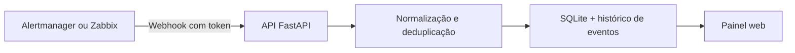

# OpsBridge

**Monitoramento → Incidente** — laboratório que recebe alertas de monitoramento, agrupa repetições e acompanha o ciclo básico de incidentes.

> Projeto educacional com dados fictícios. A configuração foi pensada para execução local e não substitui uma plataforma de incidentes pronta para produção.

## Problema

Alertas repetidos podem dificultar a triagem e esconder o que ainda precisa de atenção. O OpsBridge recebe eventos em formatos de demonstração do Prometheus Alertmanager e do Zabbix, cria um incidente por fingerprint e registra as mudanças em uma linha do tempo.

## Arquitetura e fluxo



1. O webhook valida o token e interpreta os campos principais do alerta.
2. O fingerprint identifica repetições; um alerta já aberto atualiza `last_seen` em vez de abrir outro incidente.
3. Um evento `resolved` encerra o incidente correspondente; alertas novos com o mesmo fingerprint podem reabri-lo.
4. O painel consulta a API, filtra por status e permite resolver manualmente.

## Tecnologias

- Python 3.12, FastAPI e SQLite
- HTML, CSS e JavaScript sem framework
- Docker Compose e GitHub Actions

## Executar localmente

Requisitos: Docker Engine e Docker Compose v2.

```bash
cp .env.example .env
```

Edite `.env` e configure um token aleatório. Depois inicie:

```bash
docker compose up --build -d
```

Abra [http://localhost:8080](http://localhost:8080), informe o mesmo token no painel e salve. A API publica documentação interativa em [http://localhost:8080/docs](http://localhost:8080/docs). A porta fica vinculada ao loopback do host (`127.0.0.1`).

Para parar, use `docker compose down`. Para apagar também os incidentes locais, use `docker compose down -v`.

## Enviar alertas de demonstração

O exemplo abaixo usa somente dados fictícios. Troque `SEU_TOKEN` pelo token definido em `.env`.

```bash
curl -X POST http://localhost:8080/webhooks/alertmanager \
  -H 'Authorization: Bearer SEU_TOKEN' \
  -H 'Content-Type: application/json' \
  -d '{"alerts":[{"status":"firing","fingerprint":"demo-api-01","labels":{"alertname":"EndpointDown","instance":"api-demo:8080","severity":"critical"},"annotations":{"summary":"Endpoint fictício sem resposta"}}]}'
```

O webhook simplificado `/webhooks/zabbix` aceita `alert_name`, `instance`, `severity`, `summary`, `fingerprint` e `status` (`firing` ou `resolved`). Ambos exigem o cabeçalho `Authorization: Bearer ...`.

## API principal

| Método | Rota | Uso |
| --- | --- | --- |
| `GET` | `/health` | Health check sem autenticação |
| `POST` | `/webhooks/alertmanager` | Receber um lote de alertas Alertmanager |
| `POST` | `/webhooks/zabbix` | Receber um alerta simplificado de demonstração |
| `GET` | `/api/incidents?status=open` | Listar incidentes (`all`, `open`, `resolved`) |
| `GET` | `/api/incidents/{id}/events` | Consultar o histórico de um incidente |
| `PATCH` | `/api/incidents/{id}/resolve` | Resolver manualmente |

As rotas `/api` e `/webhooks` exigem token. O `OPSBRIDGE_WEBHOOK_TOKEN` é lido do ambiente e nunca deve ser commitado.

## Testes e CI

Execute localmente com Python 3.12:

```bash
pip install -r requirements.txt
python -m unittest discover -s tests -v
```

Os testes cobrem deduplicação, resolução, rejeição de token inválido e validação de status. O workflow também valida a configuração do Compose. Use um token de teste descartável; nunca use credenciais reais no CI.

## Decisões e limites

- O SQLite simplifica a execução local; não é uma escolha para alta concorrência ou implantação multi-instância.
- O token Bearer autentica chamadas, mas não oferece gestão de usuários, rotação automatizada ou autorização por perfil.
- O painel guarda o token no `localStorage` do navegador; use apenas em ambiente local de demonstração.
- Não há fila, retentativas com backoff, integração real configurada com Zabbix, Alertmanager ou GLPI, nem notificações externas.
- O fingerprint é usado como chave de deduplicação; sistemas integrados devem enviar um identificador estável e evitar dados pessoais no payload.
- Não há TLS, HA, backup automatizado ou monitoramento do próprio OpsBridge.

## Próximos passos possíveis

1. Testar o webhook com uma instância local de Prometheus Alertmanager e documentar o mapeamento de campos.
2. Adicionar paginação, busca e filtros por severidade.
3. Avaliar PostgreSQL e migrações se surgir requisito de concorrência ou retenção maior.
4. Adicionar testes de integração do container e métricas de saúde da aplicação.
5. Só então avaliar integração com um sistema de chamados, com escopo, autenticação e tratamento de falhas definidos.

## Segurança para o laboratório

O Compose publica a porta apenas em `127.0.0.1`, executa o container como usuário sem privilégios, descarta capabilities e usa filesystem somente leitura. Essas medidas reduzem exposição no cenário local; não tornam o projeto pronto para internet ou produção.
